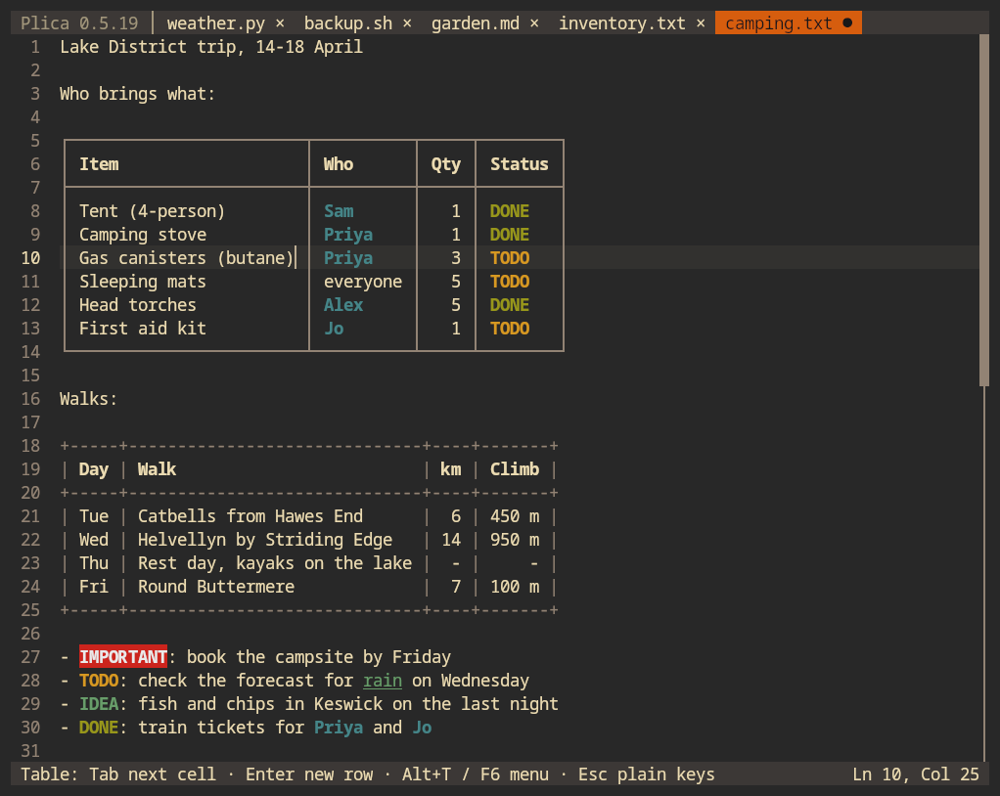
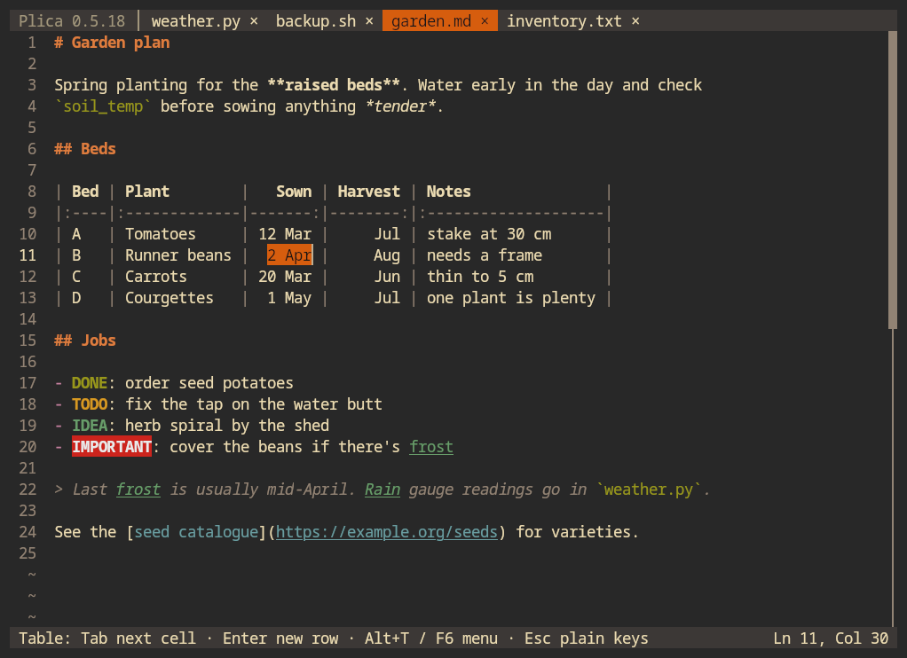
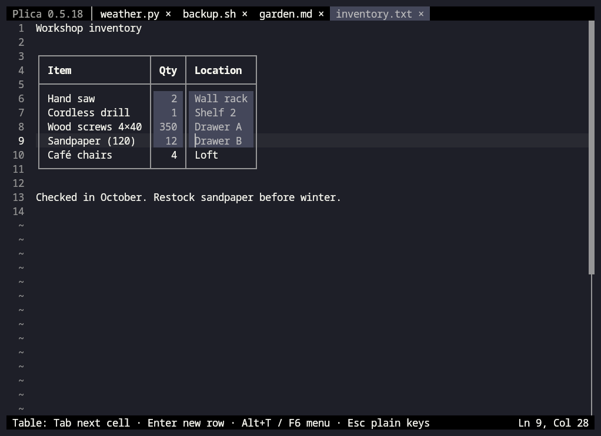
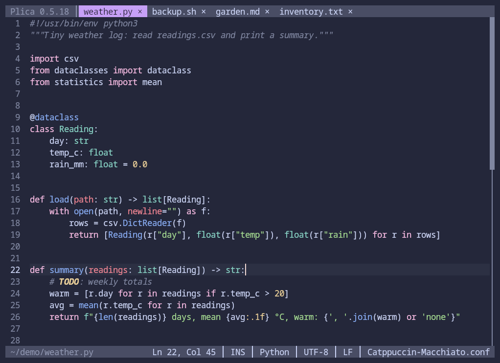
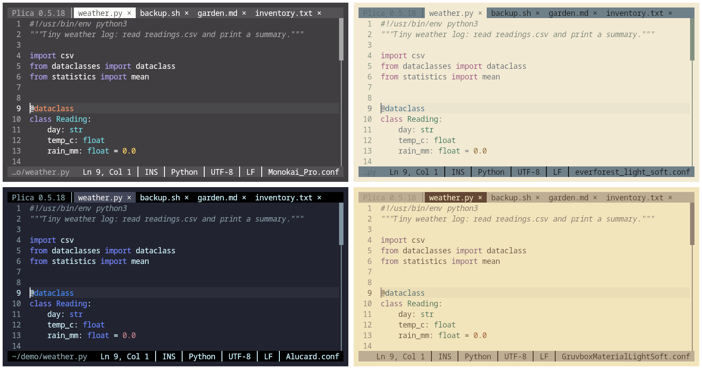
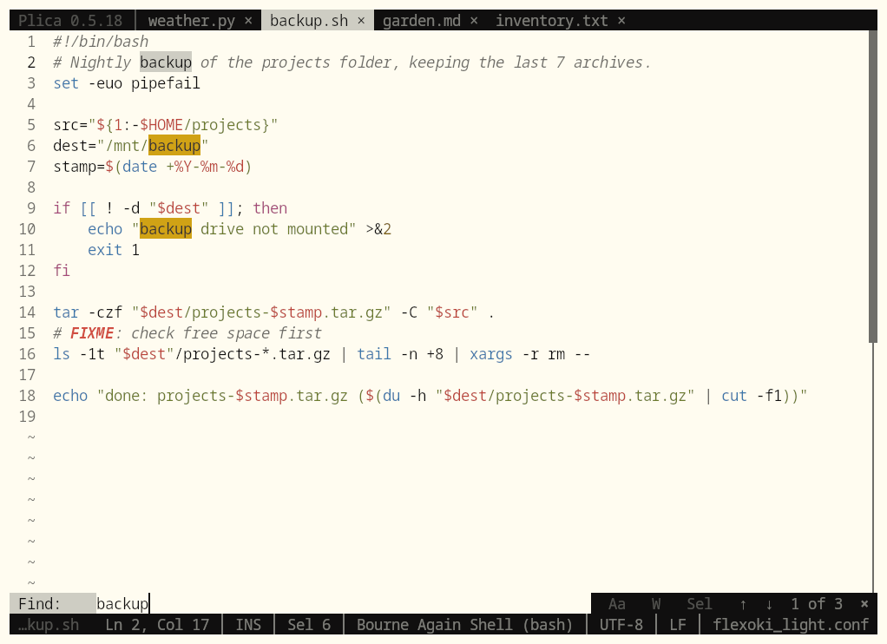
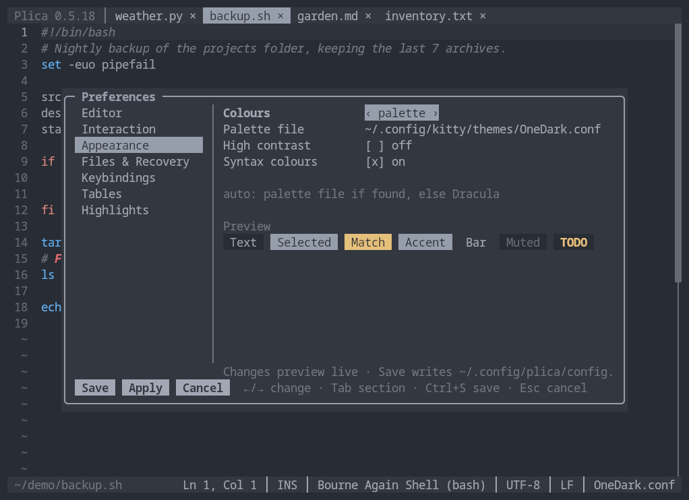

# Plica

A mouse-friendly text editor for the terminal. It keeps plain text files tidy with tables you can edit cell by cell, right in the text.

Its three distinguishing features:

- **Tables you can edit, in plain text.** Bordered tables in any text file (ASCII `+---+` or Unicode `┌───┐`) and Markdown tables are edited cell by cell: Tab between cells, columns widen and narrow as you type, rows and columns can be added or moved, and cells copy and paste to and from spreadsheets. The file stays ordinary text, readable anywhere.
- **Highlighting your own words and phrases**, across all files or just one document, without touching the file.
- **Live colours from your desktop theme:** Plica follows a Kitty-format colour file (for example the one a theme switcher writes) and recolours itself the moment it changes.



*An ordinary `.txt` file. "(butane)" was just typed into the Item cell, and the column widened to fit, borders and all. The coloured names, statuses and notes are highlights; nothing is added to the file.*

## Getting Plica

You need Linux and a terminal with mouse support. Optional: `wl-copy`, `xclip` or `xsel` for the system clipboard (otherwise Plica uses the terminal's OSC 52 clipboard).

### Download

Each release on the [Releases page](https://github.com/subbaan/plica/releases) has `plica-VERSION-x86_64-linux.tar.gz`: a static binary that runs on any x86-64 Linux, with the man page and key guide. Unpack it and put `plica` somewhere on your `PATH`:

```sh
tar xf plica-*-x86_64-linux.tar.gz
cp plica-*-x86_64-linux/plica ~/.local/bin/
```

### Build from source

You need a Rust toolchain (1.88 or newer; `rustup` or your distribution's `rust` package) and `make`.

```sh
make build        # release build; ./plica links to target/release/plica
./plica notes.txt
```

There is deliberately no `make install`; copy `target/release/plica` onto your `PATH` yourself. The man page is `docs/plica.1` (`man -l docs/plica.1` reads it in place).

## Using it

```sh
plica                       # an empty document
plica notes.md todo.txt     # one tab per file (missing files are created on save)
plica +120 big.log          # start on line 120
```

Press **F1** inside Plica for the keys, **F9** for Preferences. The full key list is in [`docs/keys.md`](docs/keys.md) (`plica --print-keys` prints it with your own bindings). The everyday keys are the usual ones: Ctrl+S save, Ctrl+Shift+S or F12 save as, Ctrl+O open, Ctrl+N new tab, Ctrl+W close, Ctrl+Z / Ctrl+Y undo / redo, Ctrl+F find, Ctrl+H replace, Ctrl+G go to line, Ctrl+Q quit.

The title bar has clickable Prefs, Save, Table, Wrap, Mouse and Help buttons (when the window is wide enough). Alt+M hands the mouse to the terminal, for its own text selection.

Files reopen where you left them, and **Alt+R** lists recent ones. **Insert** switches to overwrite mode, handy for ASCII art. The man page has the details of both.

### Tables



- **Make one:** Alt+T (or F6, or the Table button) outside a table: a new Markdown, Unicode box or ASCII table. Or type a Markdown header row followed by `|---|---|`.
- **Edit:** Tab / Shift+Tab move between cells; Tab in the last cell and Enter add a row. Typing keeps the column lined up. Backspace stops at the cell's edge. Typing `|` in a Markdown cell inserts `\|`.
- **Table menu** (Alt+T, F6, right-click or the Table button inside a table): format, insert / delete / move rows and columns, align columns, convert between Markdown, box and ASCII, select a row, column or table, copy for a spreadsheet, and a short guide.
- **Cells:** drag across cells (or Shift+arrows at a cell's edge, or click the `---` under a column) to select them. Ctrl+C copies them as tab-separated text, ready for a spreadsheet. Pasting spreadsheet cells (or Markdown rows) into a table fills it, adding rows and columns as needed.
- **Plain keys:** Esc in a table makes Tab, Enter and Backspace work as in ordinary text there. Esc again switches table keys back on. Enter at the very start or end of a table breaks the line normally.
- Wide tables don't wrap; the caret's table scrolls sideways on its own.
- **Tables off:** Preferences → Tables → Tables (`[tables] enabled = false`) treats every table as plain text, for example for ASCII art or game maps drawn with `+---+` borders.
- Only complete tables count: a Markdown header with its `---` row, or a fully bordered block. Text laid out in columns with spaces is never treated as a table. Markdown tables inside code blocks are left alone; bordered tables count anywhere.



### Syntax colours



Code and markup are coloured by language: around 200 of them, from Bash, Python, Rust, C and JavaScript to Markdown, TOML, YAML, JSON, HTML, Makefiles, diffs and Git commit messages (the grammars `bat` uses). The language comes from the file name or extension, or from a `#!` first line, so a script without an extension is recognised too. The status bar shows it; click it (or press **F4**) to choose another language, plain text, or go back to automatic.

The colours are your palette's ANSI colours (`color1`…`color6`) and roles, so they change with your theme. Highlights, search matches and the selection are drawn on top. To change them:

```toml
[syntax.colours]
comment = "color8"
keyword = "#ff79c6"
```

Preferences → Appearance → Syntax colours switches them off.

### Highlights

TODO, FIXME, IMPORTANT, IDEA and DONE are highlighted out of the box. Add your own groups (words, phrases, colours, bold/italic/underline, whole word, case, file types) in Preferences → Highlights or in `[[highlights.group]]` in the config. **Alt+H** (or F8) highlights the word under the caret in the current document only; those rules live in `~/.config/plica/documents.toml`, never in your file. In an Untitled document they're kept until you first save it, then stored for its new name.

### Colours

- **Follows Kitty:** with nothing configured, Plica uses the theme you picked with Kitty's theme selector (`kitty +kitten themes`, which writes `~/.config/kitty/current-theme.conf`) and recolours itself when you pick another.
- **Any colour file:** `--palette PATH` (or `PLICA_PALETTE`) follows any Kitty-format colour file, reloading live. A broken or missing file keeps the last good colours.
- **Built-in themes:** Dracula (the default when there's no Kitty theme), Gruvbox, Nord, Solarized Dark and Solarized Light, with `--theme NAME`.
- **Adjusting:** Preferences → Appearance has a preview and a high-contrast mode. `[appearance.colours]` in the config overrides single colours, for example `accent = "#e5a50a"`.
- `NO_COLOR` is respected.





### Files, encodings and safety

- Saves write a temporary file and rename it over the original, so a crash never leaves a half-written file. The exception is a file with hard links: it's written in place to keep the links, so that save isn't atomic. Permissions, ownership and symlinks are kept, and line endings (LF or CRLF) and a byte-order mark are preserved. A read-only file is never saved over; Plica offers Save As instead.
- A file changed by another program reloads by itself if you have no unsaved changes. If you do, Plica asks before overwriting.
- Unsaved work is snapshotted to `~/.local/state/plica/recovery/` and offered back after a crash or a closed terminal window. Your original file is never written behind your back.
- Encodings: UTF-8 (with or without BOM), UTF-16 and about 35 older encodings (Windows-125x, ISO-8859-x, KOI8, Shift_JIS, EUC-JP, GBK/GB18030, Big5, EUC-KR, …) are detected and saved back in the same encoding. Click the encoding in the status bar (or Alt+E / F7) to reopen or save in another one; `--encoding NAME` forces one. Bytes that aren't valid show as `\xNN` and are written back unchanged. A character the encoding can't store stops the save and offers UTF-8 instead.

### Configuration

The config file is `~/.config/plica/config.toml` (or `$XDG_CONFIG_HOME/plica/config.toml`).

- **Preferences (F9)** edits it for you, keeping your comments.
- **By hand:** Preferences → Keybindings → **Edit config.toml** opens it in a Plica tab (the commented template if you don't have one yet); saving it there applies your changes at once.
- `plica --print-config` prints a fully commented default; `plica --check-config` lists any problems.

A short example:

```toml
[editor]
tab_width = 2
wrap = false

[appearance]
theme = "nord"           # "auto" follows your Kitty theme

[[highlights.group]]
name = "Names"
terms = ["Alice", "Bob", "release day"]
fg = "color4"
bold = true

[keys]
toggle_overwrite = ["insert", "alt+o"]   # every command can be rebound
```



## Terminals

Developed in **Kitty**, also checked in **XFCE Terminal** and an xterm-compatible emulator. Any terminal with SGR mouse reporting should work. Some notes:

- Many terminals keep Ctrl+Shift+letter, Ctrl+Tab and Shift+click for themselves. Every such action has a fallback: F12 for Save As, Ctrl+Y for redo, Alt+click to extend a selection, Ctrl+PageUp/PageDown for tabs.
- With XFCE Terminal's menu bar shown, Alt+E, Alt+H and Alt+T open its menus. Use F7, F8 and F6 instead.
- tmux needs `set -g mouse on` (and `set -g set-clipboard on` for copying).

## Limits

- Files up to tens of megabytes stay responsive (a 35 MB, 400 000-line file is part of the test suite). The whole file is held in memory.
- A single line of several megabytes is laid out whole and gets slow. Tables and highlighting ignore lines longer than 20 000 characters; syntax colours skip lines over 8 KB.
- Syntax colours are off for files over 10 MB. After a jump far into a large file (more than 1 MB past the part already coloured), colours start fresh a little above the view, so a long multi-line string or comment that began far above may be coloured wrongly there.
- Very large tables work, but each keystroke that widens a column re-pads every row (about 0.2 s for 50 000 rows).
- Binary files and UTF-32 are refused, and EBCDIC and DOS code pages such as CP437 aren't supported.
- File ACLs and extended attributes aren't preserved on save.
- Linux only so far. Other Unix systems are untested; Windows isn't supported.

## Development

```sh
make check   # clippy (warnings are errors), unit tests, release build
make e2e     # drives ./plica in a pseudo-terminal (needs python-pexpect and python-pyte)
make perf    # large-file responsiveness test (35 MB text, 2 MB code)
```

`ARCHITECTURE.md` describes the design and keeps a log of decisions and workarounds; `CHANGELOG.md` lists user-facing changes; `PLICA_IMPLEMENTATION_PLAN_v0.1.0.md` is the original plan.

## Licence

MIT, see [`LICENSE`](LICENSE). The built-in Dracula, Gruvbox, Nord and Solarized colours are adapted from MIT-licensed themes. The Rust libraries Plica is built from are all permissively licensed, as are the syntax grammars (from [two-face](https://codeberg.org/CosmicHarper/two-face), the set `bat` ships); their licences are collected in [`THIRD_PARTY_LICENSES.md`](THIRD_PARTY_LICENSES.md) (`make notices` regenerates it).
